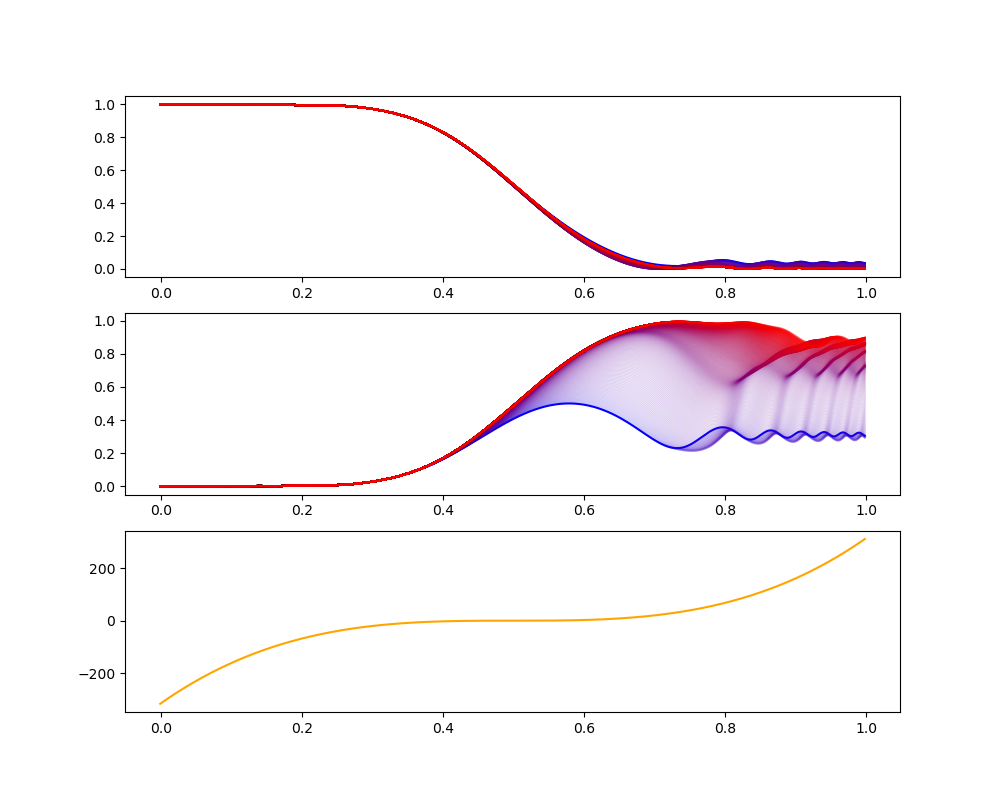

<!--<h3> Convolutional Neural Network </h3> -->

  This university project is work in progress and aims to investigate Rydberg atoms (n>50) and their interaction with each other into bell states within an electric field. In other words -> high energy atoms interacting creating a system where only one of the atoms can be in the excited state while we are pointing a laser at it. This is because of the interaction between the atoms becomes is out of phase with the external electric field for Rydberg atoms. 

